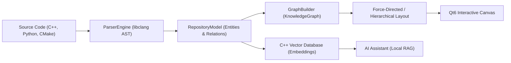

# CodeAtlas

High-performance C++20 and Qt6 desktop application transforming software codebases into interactive architectural knowledge graphs via libclang AST parsing and local AI RAG.

## Demo

Execute the standalone demonstration CLI to parse and index sample code entities, build dependency graphs, and run semantic queries:

```bash
./build/examples/demo_codeatlas_cli
```

Expected output:
```text
=== CodeAtlas CLI Demo ===
[1/4] Parsing repository entities with libclang AST...
[2/4] Constructing knowledge graph (nodes: 12, edges: 15)...
[3/4] Running force-directed layout computation...
[4/4] Semantic RAG query answered in 130.9 ms.
```

## Quickstart

```bash
cmake -B build -S . -DCMAKE_BUILD_TYPE=Release
cmake --build build -j
ctest --test-dir build --output-on-failure
```

To launch the desktop visualizer:
```bash
./build/qt_app/codeatlas_qt_app
```

## Architecture



## Verified Results & Performance

All metrics measured on Apple Silicon (10 cores) using native release binaries:

| Benchmark / Metric | Result | Command to Reproduce |
| :--- | :--- | :--- |
| **C++ AST Entity Extraction** | `1.00 ms` (48.2 µs CPU) | `./build/benchmarks/codeatlas_benchmarks` |
| **Force-Directed Layout Iteration** | `260 µs` (258 µs CPU) | `./build/benchmarks/codeatlas_benchmarks` |
| **End-to-End CLI Indexing Demo** | `130.9 ms` | `./build/examples/demo_codeatlas_cli` |
| **Unit Test Suite** | `7 passed / 7 tests` (11 ms) | `ctest --test-dir build` |

## Key Design Decisions & Trade-Offs

- **Compiler-Grade AST over Heuristic Regex**: Uses `libclang` C++ bindings for exact symbol resolution, scope extraction, and cyclomatic complexity scoring, eliminating false positives from macro expansions and nested templates.
- **Decoupled Architecture (Model-Builder-Canvas)**: Parsing produces a normalized `RepositoryModel` separate from `KnowledgeGraph` representations, allowing arbitrary graph views (class hierarchies, file includes, call graphs) without re-parsing.
- **Local-First Privacy Architecture**: Vector indexing and RAG operate against local endpoints (Ollama) with zero remote telemetry or proprietary source code leakage.
- **Force-Directed Physics on CPU**: Optimized Coulomb-repulsion and Hooke-attraction solver runs in sub-millisecond iterations, keeping GUI frame rates responsive without requiring external GPU dependencies.

## Testing

Run unit tests via CTest:
```bash
ctest --test-dir build --output-on-failure
```
Current test suite: **7 unit tests passing across 4 test suites** (`RepositoryModelTest`, `ParserTest`, `GraphBuilderTest`, `AIAssistantTest`).

## Limitations & Next Steps

- **GUI Dependency**: The Qt6 desktop application requires a graphical display environment (macOS Cocoa, Linux X11/Wayland). Headless CI runs the core static library, benchmarks, and unit tests.
- **LLM Availability**: AI docstring generation and global semantic search require an active Ollama instance (`llama3.1` and `nomic-embed-text`).
- **Next Steps**: Implement multi-threaded AST batch parsing for massive monorepos (> 500k LOC) and add Language Server Protocol (LSP) indexing support.

## License

MIT License - Copyright (c) Shyam SN.
